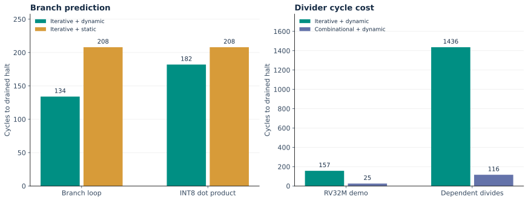
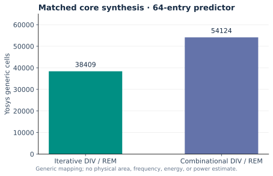
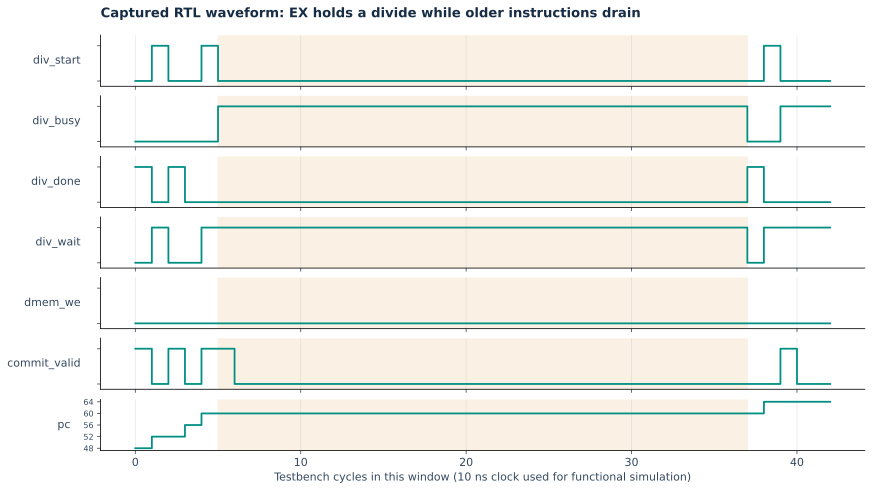

# RV32Forge

**An inspectable five-stage RV32IM processor with reproducible verification.**

SystemVerilog · dynamic branch prediction · iterative division · forwarding · MMIO · retirement tracing


RV32Forge is a small in-order processor for learning, microarchitecture experiments, and RTL portfolio work. The core exposes enough execution detail to explain a result and reproduce it: an ordered instruction trace, separate load-use and divider stall counters, selectable prediction/division policies, and an independent Python architectural model.

The included environment uses **ECALL as a drained simulation halt**. It does not implement a privileged RISC-V execution environment, CSRs, interrupts, or a trap vector. See [execution scope](docs/architecture.md#execution-scope).

## What improved in this version

- **Correct subword loads.** The memory wrapper returns an aligned word; the core selects the byte or halfword once. Signed loads and the final bytes of RAM have directed tests.
- **Ordered stopping.** ECALL, EBREAK, illegal encodings, and alignment faults stop younger work, drain older instructions, and finish at WB. Counters and side effects stop with the core.
- **A real multicycle divider.** DIV/DIVU/REM/REMU share a 32-step restoring datapath, including signed correction and defined arithmetic corner cases. EX back-pressure preserves pipeline ownership without replaying stores.
- **One shared multiplier.** Sign extension supports all four RV32M multiplication operations with one product expression.
- **Observable correctness.** Every architectural event can be compared against the Python model; final registers and every byte of test RAM are checked as well.
- **Reproducible comparisons.** Static versus dynamic prediction and iterative versus combinational division use the same programs and corrected core.
- **A usable toolchain.** Checked assembly operands, full 32-bit `li`, ABI names, source-line errors, Python unit tests, CI, generated diagrams, waveform evidence, and synthesis scripts.

## Quick start

On Ubuntu/Debian, or **Ubuntu in WSL on Windows**:

```bash
sudo apt-get update
sudo apt-get install -y python3 gcc make iverilog
cd RV32Forge
make quick
```

Run the complete functional suite:

```bash
make test
```

This runs Python tool tests, host C golden models, assembly/reference checks, the directed RTL demos, arithmetic/predictor/MMIO/reset unit benches, and a three-configuration differential regression. No pip packages or RISC-V cross compiler are required for these commands.

Optional lint and generic synthesis:

```bash
sudo apt-get install -y verilator yosys
make lint
make synth
```

`make check` runs functional tests, lint, and synthesis together. `make help` lists the main entry points. Generated work goes under `build/`; compact measured reports are under `results/`.

### Windows / VS Code

Use a WSL terminal in VS Code for the Makefile workflow. For example:

```bash
cd /mnt/c/Users/surface/Downloads/RV32Forge
make quick
make test
```

Native PowerShell is also supported if Python 3 and Icarus (`iverilog` and `vvp`) are on PATH:

```powershell
powershell -ExecutionPolicy Bypass -File .\scripts\test.ps1
```

The PowerShell runner executes Python tests and the full RTL differential suite. GNU Make, GCC, Verilator, and Yosys are needed only for their corresponding extra targets.

## Verified results in the package

| Check | Recorded result |
|---|---:|
| Python test methods | 19 passed |
| Divider operand/mode vectors | 2,048 passed |
| Combinational RV32M vectors | 4,096 passed |
| Predictor, MMIO, reset benches | Passed |
| Differential RTL program runs | 111 passed |
| Matched architectural events | 13,863 |
| Divider/predictor configurations | 3 |
| Verilator lint | Both divider configurations passed |
| Yosys synthesis `check -assert` | Both divider configurations passed |

The 111 runs are **37 programs repeated across three configurations**, including 12 deterministic random programs. Counts are testing evidence, not an ISA certification or formal proof. Read [verification](docs/verification.md) for what is checked and [measured results](docs/results.md) for the exact configurations and tradeoffs.



On the included 40-iteration loop, dynamic prediction reduces drained-halt cycles from **208 to 134**, with **2 versus 39** mispredictions. On the signed INT8 dot product, it reduces cycles from **208 to 182**. These are cycle comparisons for these workloads.



With the same 64-entry dynamic predictor and observable core outputs, Yosys reports **38,409 generic cells with iterative division** versus **54,124 with combinational division**, a **29.0% reduction**. Iterative division adds stalls: the divide-heavy benchmark takes **1,436 versus 116 cycles**. No standard-cell area, frequency, power, or energy benefit is inferred from generic cell counts or a testbench clock.

## Run and inspect a program

```bash
make asm
python3 tools/rv32im_ref.py programs/dot_product.hex
make sim          # pipeline/hazard demo + VCD
make sim-m        # all eight RV32M instructions
make sim-branch   # dynamic predictor loop
make sim-mmio     # readable performance counters
```

The dot product uses signed byte loads, multiplication, accumulation, and a loop. Its 16-element result is **−137**, stored as `0xffffff77` at data address `0x300`.

Write assembly using real RV32IM instructions or the supported small set of pseudos:

```asm
li   a0, 0x80000000    # expanded into LUI + ADDI
li   a1, -1
div  a2, a0, a1
sw   a2, 256(zero)
ecall                  # drain the pipeline and stop
```

```bash
python3 tools/mini_rv32_asm.py my_program.s my_program.hex
python3 tools/rv32im_ref.py my_program.hex --trace my_reference.jsonl
```

`lui a0, 0x12345` uses the standard **20-bit immediate field** and produces `0x12345000`. This replaces the older assembler's shifted-immediate convention. Branch/jump labels are relative; numeric branch/jump operands are byte displacements. `jalr rd, rs1, offset` is the supported JALR source spelling. The assembler rejects out-of-range immediates, invalid registers, duplicate/unknown labels, and odd branch offsets.

## Configuration and trace

| Parameter | Default | Meaning |
|---|---:|---|
| `ITERATIVE_DIV` | 1 | 32-step divider; 0 selects the combinational comparison implementation |
| `ENABLE_BP` | 1 | Tagged BTB + two-bit prediction; 0 is static not-taken |
| `BP_ENTRIES` | 256 | Power of two, at least 2 |
| `IMEM_WORDS` (SoC) | 2,048 | Separate simulation instruction RAM |
| `DMEM_BYTES` (SoC) | 65,536 | Simulation data RAM; positive multiple of 4 |

The regression uses a **64-entry predictor and 4 KiB data RAM** for all compared configurations. Synthesis also uses 64 predictor entries and excludes the simulation memory wrapper.

`commit_*` outputs report PC, instruction, register write, store effect, and terminal/fault status in program order. They are a project-specific debug interface; they are not RVFI. See [trace interface](docs/interfaces.md).

```bash
python3 tools/regress.py --seeds 20 --length 250 --seed 100 --wave
# Inspect build/regression/<configuration>_cases/<program>/
#   program.s, program.hex, rtl.trace, reference.jsonl, rtl.state, simulation.log
```



For GTKWave:

```bash
gtkwave build/waves/demo.vcd
# Or the divide trace captured by make regression:
gtkwave build/regression/iterative_dynamic_cases/divider_dependencies/wave.vcd
```

## Memory map

| Address | Device |
|---|---|
| `0x00000000 ... DMEM_BYTES-1` | Little-endian data RAM |
| `0x10000000` | UART transmit: low byte of a store, simulation output |
| `0x10000010` | Active cycles |
| `0x10000014` | Retired normal instructions |
| `0x10000018` | Load-use stall cycles |
| `0x1000001c` | Resolved conditional branches and jumps |
| `0x10000020` | Mispredicted control transfers |
| `0x10000024` | Divider stall cycles |

Counters are 32-bit, read-only, and freeze at halt. Natural alignment is required. Unmapped reads return zero; unmapped writes are ignored. Instruction and data memories are separate. [Architecture and memory contract](docs/architecture.md) contains the full behavior.

## Repository guide

| Location | Contents |
|---|---|
| `rtl/` | Core, SoC simulation wrapper, arithmetic, predictor, register file, immediate and legality decode |
| `tb/` | Self-checking RTL benches and trace-producing regression harness |
| `programs/` | Assembly workloads and regenerated hex images |
| `tools/` | Assembler, architectural model, regression, synthesis, SVG diagrams, measured plots |
| `tests/` | Python tool and model tests |
| `sw/` | Original host C golden examples |
| `results/` | Actual JSON/CSV reports and validation summary |
| `docs/` | Architecture, interfaces, verification, measured results, generated vector figures |
| `examples/` | A captured instruction trace and divider waveform |

## Rebuild the figures

```bash
python3 tools/draw_architecture.py         # standard library only
python3 -m pip install -r requirements-viz.txt
make plots                               # reads results/*.json and the captured VCD
```

Optional visualization dependencies are separate from the functional toolchain. No invented benchmark or physical implementation values are used in the figures.

## Next research steps

The current interfaces make a useful starting point for a variable-latency memory bus, machine-mode CSRs and traps, FPGA RAM inference, or formal properties. Those require additional implementation and validation. A technology-mapped ASIC flow would also need a real cell library, constraints, STA, and physical implementation before making PPA claims.

[Changelog](CHANGELOG.md) · [Contributing](CONTRIBUTING.md) · [MIT license](LICENSE)

**Matin Firoozbakht** · [github.com/matinfirooz](https://github.com/matinfirooz)
