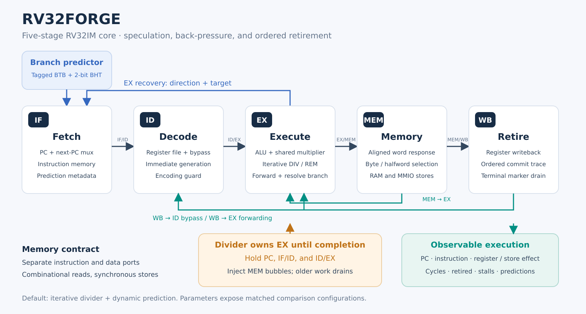
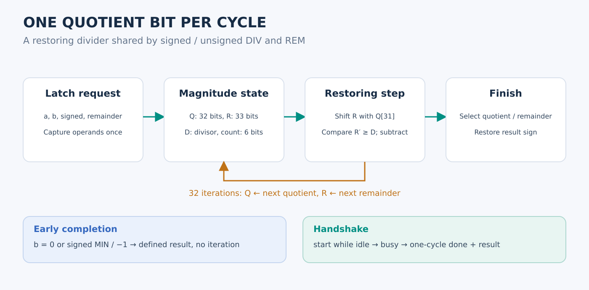
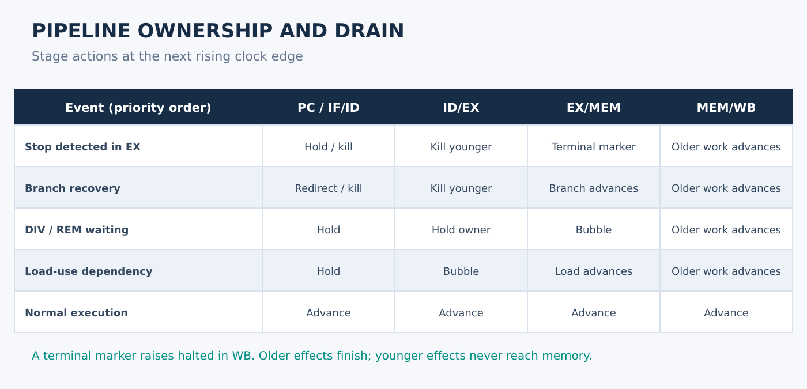

# Microarchitecture

RV32Forge is an in-order five-stage core with speculative instruction fetch. A single instruction owns EX. ALU and multiply operations advance in one EX cycle; an iterative divide holds that instruction until the divider signals completion.

## Execution scope

The integer datapath supports the RV32I arithmetic, logical, upper-immediate, load/store, branch, and jump operations, and all eight RV32M operations. FENCE is an ordered no-op in the provided memory environment. The following are intentionally outside this implementation: compressed instructions, atomics, floating point, CSRs, FENCE.I, privileged mode, interrupts, instruction/data access-fault inputs, and trap-vector execution.

ECALL is a simulation terminal marker. EBREAK, illegal/reserved encodings, and misaligned memory/control operations produce a diagnostic halt rather than vectoring into a privileged handler. These conventions must be considered before using compiled software or claiming ISA compliance.

## Fetch and prediction

Each predictor entry contains a valid bit, full PC tag, target, and a two-bit saturating counter. A taken prediction requires a matching valid tag and a counter whose high bit is one. An entry replacement initializes to weak taken or weak not-taken according to the current outcome; an unrelated branch does not inherit the displaced branch's history.

IF/ID and ID/EX carry predicted direction and target. EX compares the prediction with the actual outcome. A direction mismatch, or a target mismatch on a predicted-taken transfer, redirects fetch and kills both younger pipeline stages. JAL and JALR use the same BTB mechanism. JALR clears target bit zero before checking the remaining alignment.

`ENABLE_BP=0` selects static not-taken fetch and disables predictor training. `BP_ENTRIES` must be a power of two of at least two entries. The default core has 256 entries; the supplied regression and matched synthesis use 64.

## Decode and dependencies

The register file has two asynchronous read ports and one clocked write port, with x0 hardwired to zero. WB-to-ID bypass removes same-cycle read/write ambiguity. EX operands use the newest available producer, with EX/MEM priority over MEM/WB. EX/MEM load values are excluded because memory data is not yet available there.

Source-use decode distinguishes real dependencies from immediate bit patterns. A load-use dependency inserts one ID/EX bubble while holding PC and IF/ID. This applies to arithmetic, branch operands, JALR bases, and store data as appropriate. Writes to x0 create no dependency.

## Multiplication and division

The shared multiplier sign-extends each operand to 33 bits according to MULH/MULHSU/MULHU and selects the low or high 32 bits of the product. The low product of MUL is independent of signed interpretation.

The iterative divider latches the request and magnitudes. Each iteration shifts one dividend bit into the partial remainder, conditionally subtracts the divisor, and appends the resulting quotient bit. The last iteration selects quotient or remainder and restores its sign.

Normal division takes 32 calculation iterations after acceptance. This integration counts **33 held EX cycles** per normal divide: acceptance plus the 32 steps. Divide-by-zero and signed-overflow requests complete directly and contribute one held cycle. Signed quotients truncate toward zero; the remainder has the dividend's sign when nonzero. A zero divisor produces an all-ones quotient or the original dividend as remainder. Signed MIN divided by −1 returns MIN with remainder zero.

While waiting, PC, IF/ID, and ID/EX hold. EX/MEM receives bubbles, allowing older instructions to drain through MEM and WB exactly once. Completion releases the divider owner into EX/MEM. A following dependent instruction receives its result through normal forwarding. Reset aborts an in-flight request and clears busy/done.

`ITERATIVE_DIV=0` retains combinational division for matched experiments. Its lower cycle count does not establish a higher physical throughput: no timing constraint is applied by functional simulation.

## Control priority and stopping

At EX, a terminal instruction or fault kills younger work and inserts a terminal marker into the remaining pipeline. Older work continues. The marker raises `halted` only when it reaches WB, after all older register writes and stores have completed. Normal retirement excludes the terminal marker; the debug trace includes it as a final event.

Fault priority is illegal encoding, EBREAK, taken control-transfer misalignment, then load/store misalignment. Natural alignment is required: word addresses divisible by four and halfword addresses divisible by two. A conditional branch to a misaligned target faults only when taken. The faulting instruction's register write and memory operation are suppressed. Outputs report the source instruction PC and the diagnostic cause.

| `faulted` | `fault_cause` | Meaning |
|---:|---:|---|
| 0 | 0 | ECALL terminal marker |
| 1 | 0 | Instruction target misaligned |
| 1 | 2 | Illegal or unsupported instruction |
| 1 | 3 | EBREAK |
| 1 | 4 | Load address misaligned |
| 1 | 6 | Store address misaligned |

These cause numbers follow the corresponding RISC-V exception numbering, but there is no `mepc`, `mcause`, `mtvec`, or trap return mechanism. `fault_pc` identifies the terminal instruction even on a clean ECALL halt.

## Memory contract

The core has separate instruction and data ports. Reads are combinational with no ready/valid handshake or wait states. Stores commit at a rising edge. Integration with synchronous block RAM, a cache, AXI, or Wishbone needs an explicit latency adapter and additional pipeline flow control.

For a data read, the wrapper returns the 32-bit word starting at `dmem_addr & ~3`. The core selects the lane using the original address and then sign/zero extends it. Stores use the original byte address and unshifted low byte(s) of `dmem_wdata`. This one-time lane selection fixes the uploaded version's mismatch between wrapper and core.

The SoC is a **simulation harness**, not an FPGA/ASIC memory macro implementation. RAM is initialized once to zero. Reset restarts the core and counters but retains data RAM. Instructions initialize to NOP; the program image replaces the loaded words. A fetch beyond the image's initialized instructions sees NOP until a timeout or a terminal instruction. Unmapped data reads return zero, and unmapped writes are ignored. Naturally aligned subword reads of counter words use the same lane selection as RAM.

UART is simulated by printing the store's low byte at `0x10000000`. This is not a physical UART serializer. Counters are read-only and 32-bit modulo counters; they freeze with halt.

## Counters

- `cycle_count`: active cycles after reset, including bubbles, stalls, and terminal drain.
- `instret_count`: normal instructions passing WB; terminal markers are excluded.
- `stall_count`: load-use stall cycles, excluding divider hold cycles.
- `div_stall_count`: cycles in which the EX divider owner holds the pipeline.
- `branch_count`: resolved conditional branches, JAL, and JALR, excluding faulting transfers.
- `mispredict_count`: direction or target mismatches on those transfers.

CPI is `cycle_count / instret_count` for a nonempty run. Predictor counts include jumps; comparisons must use the same program, reset policy, and terminal convention.

## Primary ISA references

- [RISC-V RV32I specification](https://docs.riscv.org/reference/isa/v20260120/unpriv/rv32.html)
- [RISC-V M-extension specification](https://docs.riscv.org/reference/isa/v20240411/unpriv/m-st-ext.html)

The public specifications define arithmetic and encoding behavior. The execution-environment restrictions above describe this implementation.
