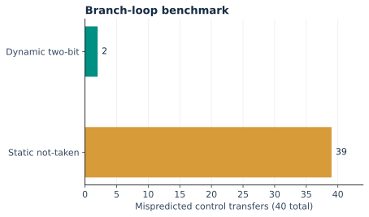

# Measured results

These numbers come from the included RTL simulation and generic synthesis reports. They use the corrected core in every configuration.

## Functional evidence

- 111 differential program runs; 13,863 matching instruction events.
- 37 programs per configuration: 5 checked-in architectural workloads, 20 directed stress/fault cases, and 12 generated programs.
- Random seeds 42–53, 180 operation groups per generated program.
- 64 predictor entries, 4 KiB data RAM, and 4,096 instruction words in the regression.
- Terminal markers are traced and excluded from normal retirement.
- Arithmetic units: 2,048 iterative divider vectors and 4,096 combinational multiply/divide vectors.
- Predictor saturation/aliasing, timing-dependent counter MMIO, in-flight reset, and post-halt behavior have separate benches.

## Cycle and prediction comparison

| Workload | Iterative + dynamic | Iterative + static | Combinational + dynamic | Normal instructions |
|---|---:|---:|---:|---:|
| `demo` | 30 | 30 | 30 | 18 |
| `branch_bench` | 134 | 208 | 134 | 125 |
| `dot_product` | 182 | 208 | 182 | 157 |
| `rv32m_demo` | 157 | 157 | 25 | 20 |
| `div_bench` | 1436 | 1470 | 116 | 107 |

Cycles run from release of reset through the drained terminal event. Static prediction means always not-taken. The combinational divider executes a divide in one EX cycle in simulation; no achieved hardware frequency is attached to that cycle.

The loop has 40 resolved conditional branches. Static prediction misses 39, while the two-bit dynamic predictor misses 2. The resulting cycle reduction is 35.6% for this loop (208 to 134). This is a small directed predictor example, not a general application benchmark.

The signed INT8 dot product has 16 load-use bubbles and a known result of −137 at 0x300. Dynamic prediction reduces its cycles from 208 to 182.

The divide-heavy program executes 40 normal DIV/REM operations. The iterative configuration records 1,320 divider stall cycles and takes 1,436 total cycles, compared with 116 for the combinational configuration. A physical throughput comparison additionally requires each implementation's achieved clock frequency.

## Matched generic synthesis

| Core configuration | Generic cells | Flip-flop cells |
|---|---:|---:|
| iterative_divider | 38,409 | 6,407 |
| combinational_divider | 54,124 | 6,236 |

Both runs use Yosys 0.33, `synth -top rv32_core -flatten`, the default ABC generic mapping, a 64-entry dynamic predictor, and all observable core outputs retained. The SoC RAM/MMIO wrapper is excluded. Both `check -assert` runs pass.

Iterative division reduces the total generic-cell count by 29.0% while adding divider state and stalls. Generic cells are logic primitives, not equal-area standard cells. The reports do not establish a 29% silicon-area or energy reduction. No liberty mapping, STA, FPGA implementation, placement, routing, parasitics, or power analysis was run.

## Source and reproduction

- `results/regression.json` and `.csv`: every program/configuration, cycles, normal retirements, stall cycles, branch counts, mispredictions, and faults.
- `results/synthesis.json`: tool/version/method and cell-type counts for both configurations.
- `results/yosys_*.json`: direct Yosys statistics.
- `results/validation.txt`: completed-check summary.
- `examples/divider.vcd`, `.trace`, and `_reference.jsonl`: a captured passing execution.

Run `make test`, `make lint`, and `make synth` to regenerate evidence. `make plots` rebuilds the charts; `python3 tools/draw_architecture.py` rebuilds the architecture figures. Counts can change with tool versions and RTL changes. No reference-model-only numbers are labeled as RTL results.
